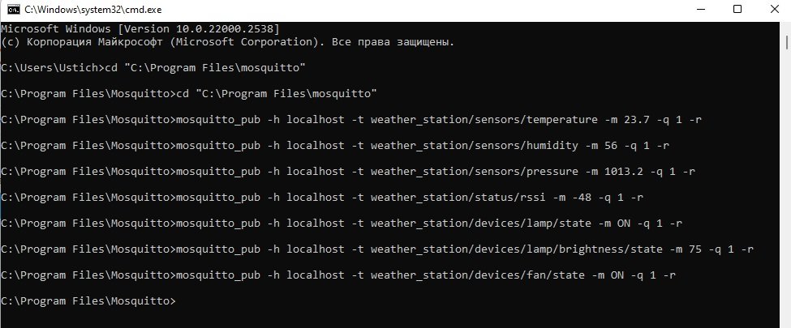
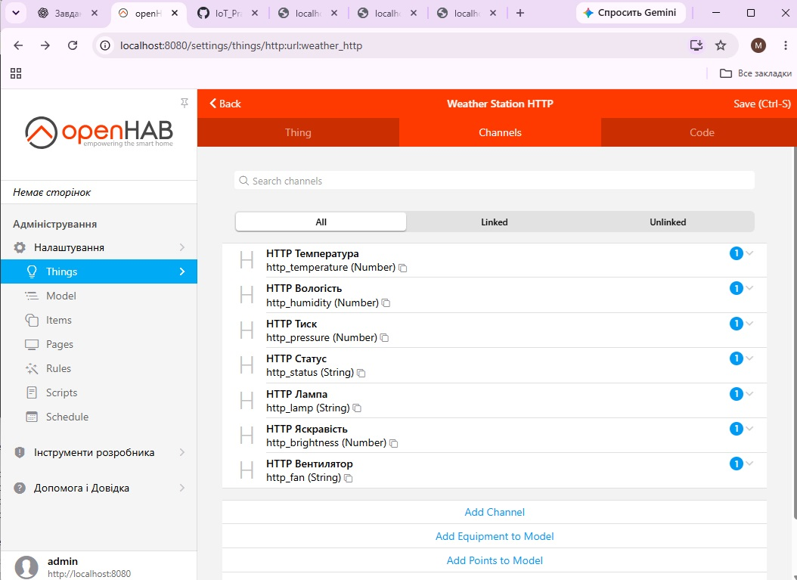
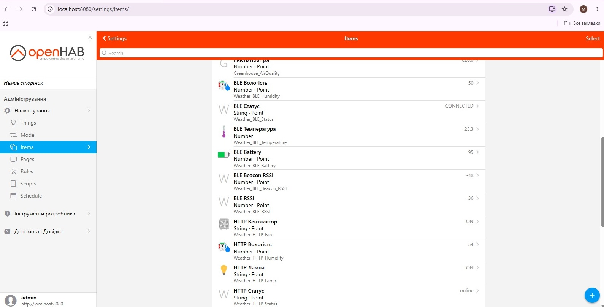
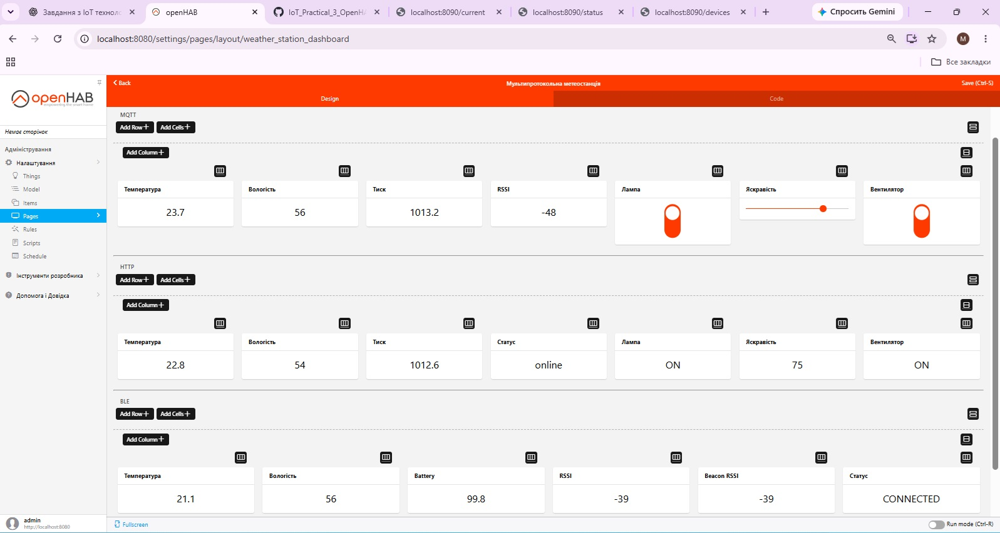
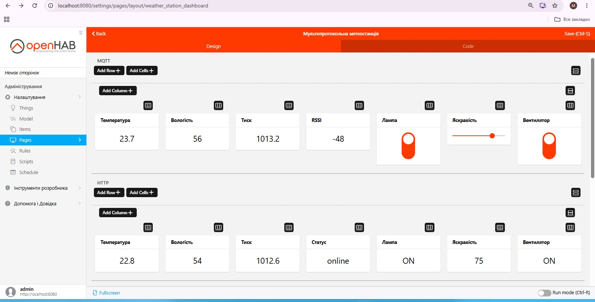
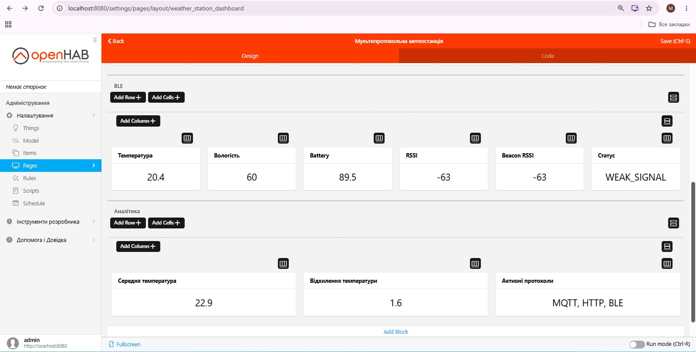

# Практична робота 3.1 — Протоколи зв'язку в IoT

## Мультипротокольна погодна станція

Мета роботи — розробити в OpenHAB емулятор IoT-системи, яка демонструє роботу трьох протоколів зв'язку: MQTT, HTTP REST API та BLE.

У проєкті передбачено:
- MQTT-телеметрію погодних даних;
- HTTP REST API емуляцію;
- BLE емуляцію датчиків і beacon;
- інтеграцію даних у OpenHAB;
- тестування та аналіз роботи протоколів.

## MQTT

Для обміну даними використовується локальний MQTT-брокер Mosquitto та MQTT Binding в OpenHAB.

Створені MQTT-канали:
- температура — `weather_station/sensors/temperature`;
- вологість — `weather_station/sensors/humidity`;
- атмосферний тиск — `weather_station/sensors/pressure`;
- RSSI — `weather_station/status/rssi`;
- стан лампи — `weather_station/devices/lamp/state`;
- яскравість лампи — `weather_station/devices/lamp/brightness/state`;
- стан вентилятора — `weather_station/devices/fan/state`.

Для перевірки передавання повідомлень використано QoS 1 та параметр retain.

Тестові значення:
- температура — 23.7;
- вологість — 56;
- тиск — 1013.2;
- RSSI — -48 dBm;
- лампа — ON;
- яскравість — 75%;
- вентилятор — ON.

### Тестування MQTT

## HTTP REST API

Для емуляції HTTP REST API створено локальний Python-сервер на порту `8090`.

Використані endpoints:
- `/current` — температура, вологість і атмосферний тиск;
- `/status` — стан системи;
- `/devices` — стан лампи, яскравість і вентилятор.

У OpenHAB створено HTTP URL Thing з базовою адресою:

`http://localhost:8090`

Для обробки JSON-відповідей використано JSONPath Transformation.

Створені HTTP-канали:
- HTTP Температура;
- HTTP Вологість;
- HTTP Тиск;
- HTTP Статус;
- HTTP Лампа;
- HTTP Яскравість;
- HTTP Вентилятор.

### HTTP Channels

## BLE

Для BLE-частини в OpenHAB було створено віртуальний контролер `BLE Virtual Adapter`.

На Windows контролер відобразив помилку:

`COMMUNICATION_ERROR — No Physical Bluetooth adapters found`

Тому BLE-пристрої реалізовано програмною емуляцією через Items і Rule DSL.

Створені BLE Items:
- `Weather_BLE_Temperature` — температура;
- `Weather_BLE_Humidity` — вологість;
- `Weather_BLE_Battery` — рівень батареї;
- `Weather_BLE_RSSI` — рівень сигналу;
- `Weather_BLE_Beacon_RSSI` — RSSI BLE-маяка;
- `Weather_BLE_Status` — стан з'єднання.

Правило `BLE Емуляція` виконується кожні 25 секунд та:
- змінює температуру і вологість;
- генерує RSSI;
- моделює поступовий розряд батареї;
- оновлює RSSI BLE-маяка;
- визначає стан `CONNECTED` або `WEAK_SIGNAL`.

### BLE Emulation

## Мультипротокольний Dashboard

Для спільного моніторингу створено сторінку OpenHAB `Мультипротокольна метеостанція`.

На одній сторінці відображаються дані трьох протоколів:

- MQTT — температура, вологість, тиск, RSSI та керування пристроями;
- HTTP — дані REST API `/current`, `/status` і `/devices`;
- BLE — температура, вологість, Battery, RSSI, Beacon RSSI та стан з'єднання.

## Підсумковий Dashboard

Для зручного моніторингу система об'єднана на одній сторінці OpenHAB.

### MQTT та HTTP

У верхній частині Dashboard відображаються:

- MQTT: температура, вологість, тиск, RSSI, стан лампи, яскравість та вентилятор;
- HTTP: температура, вологість, тиск, статус системи, стан лампи, яскравість та вентилятор.

### BLE та аналітика

BLE-частина містить:
- температуру;
- вологість;
- рівень заряду Battery;
- RSSI;
- Beacon RSSI;
- стан з'єднання.

BLE-дані автоматично оновлюються кожні 25 секунд.

Аналітичний блок виконує порівняння даних різних протоколів та відображає:
- середню температуру;
- відхилення температури;
- активні протоколи MQTT, HTTP і BLE.

